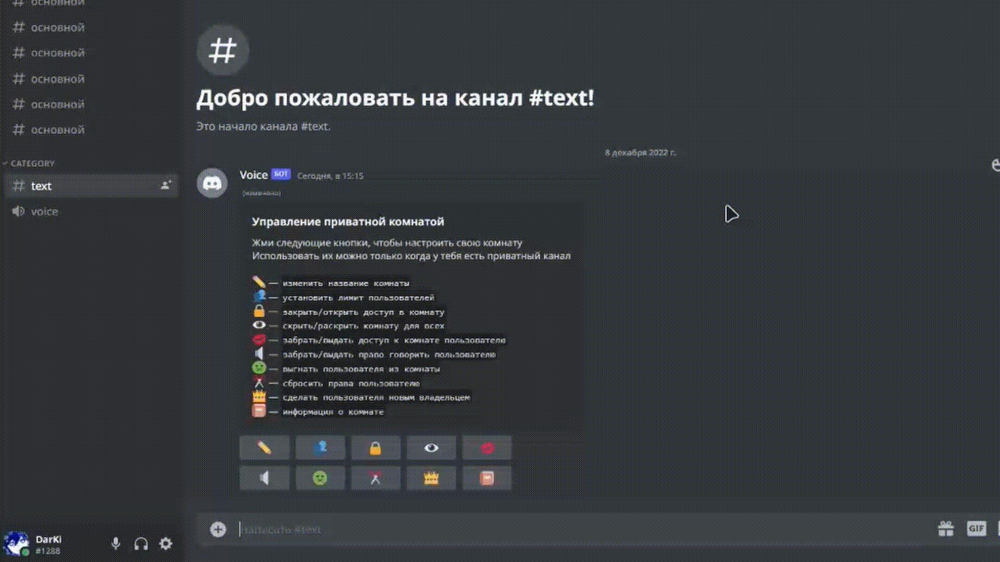

<div align="center">

# 🎙️ Discord Voice Manager

<p align="center">
  <b>Автономний бот для керування тимчасовими приватними голосовими кімнатами в Discord.</b><br>
  <i>Zero-Command Plug & Play • Zero Privileged Intents • На базі Bun та Drizzle ORM</i>
</p>

<p align="center">
  <a href="https://bun.sh"></a>
  <a href="https://discord.js.org"></a>
  <a href="https://orm.drizzle.team"></a>
  <a href="https://bun.sh/docs/api/sqlite"></a>
  <a href="../../LICENSE"></a>
</p>

<p align="center">
  <a href="../../README.md">English</a> •
  <a href="./README.ru.md">Русский</a> •
  <a href="./README.zh-CN.md">简体中文</a> •
  <a href="./README.ja.md">日本語</a> •
  <a href="./README.pt-BR.md">Português</a> •
  <a href="./README.es.md">Español</a> •
  <a href="./README.ko.md">한국어</a> •
  <a href="./README.de.md">Deutsch</a> •
  <a href="./README.fr.md">Français</a> •
  <b>Українська</b>
</p>

<p align="center">
  
</p>

---

</div>

## 🌟 Чому Discord Voice Manager?

* 🚀 **Zero-Command Auto-Setup:** Жодних слеш-команд у меню `/` вашого сервера. Бот автоматично створює категорію, канал-тригер та панель керування під час приєднання.
* ⚡ **Надшвидкий (Bun Runtime):** Пряме виконання TypeScript із субмілісекундним запуском та вбудованим hot-reload.
* 🛡️ **Типобезпечна вбудована БД:** Drizzle ORM поверх нативного `bun:sqlite` — 0 зовнішніх серверів баз даних та 0 проблем зі складанням через `node-gyp`.
* 🔒 **100% відповідність Discord API v10:** Використовуються лише базові інтенты `Guilds` та `GuildVoiceStates`. Жодних привілейованих інтентів та відмов у верифікації.
* 🛡️ **Захист від стану гонитви (Mutex):** Блокування на рівні користувача запобігають утворенню каналів-привидів при швидкому спамі входом/виходом.
* 🎨 **Мультисерверна кастомізація:** Індивідуальне налаштування кольорів, емодзі, назв і текстів кнопок для кожного сервера.

---

## 🎛️ Можливості панелі керування

Власники кімнат керують своїми каналами в реальному часі за допомогою кнопок, модальних форм та меню вибору учасників:

* ✏️ **Перейменувати кімнату** — зміна назви із захистом від кулдауну.
* 👥 **Ліміт користувачів** — налаштування місткості каналу (`0` для необмеженої кількості).
* 🔒 **Закрити / Відкрити** — перемикання права підключення для `@everyone`.
* 👁️ **Приховати / Показати** — перемикання видимості каналу для `@everyone`.
* 👤 **Доступ користувачеві** — надання або скасування права на підключення окремим учасникам.
* 🔈 **Мут / Розмут** — надання або скасування права говорити у голосовому каналі.
* 🚫 **Вигнати (Kick)** — примусове відключення учасника з вашої кімнати.
* 👑 **Передати права** — передача володіння кімнатою іншому учаснику.
* 🔄 **Скинути права** — очищення всіх персональних оверрайдів прав.
* ℹ️ **Інформація про кімнату** — перегляд поточної статистики, часу створення та прав.

---

## 🚀 Швидкий старт

### 1. Клонування та встановлення залежностей
```bash
git clone https://github.com/oneheka/Discord-Voice-Manager.git
cd Discord-Voice-Manager
bun install
```

### 2. Налаштування змінних оточення
Створіть файл `.env` у корені проєкту:
```env
DISCORD_TOKEN=ваш_токен_бота
```

### 3. Запуск
```bash
# Режим розробки (з hot-reload)
bun run dev

# Продакшн запуск
bun start
```

---

## 🛠️ Необхідні права бота (OAuth2)

Під час створення посилання-запрошення для бота в Discord Developer Portal виберіть наступні дозволи:
* `Manage Channels` (Керування каналами)
* `Move Members` (Переміщення учасників)
* `Send Messages` (Надсилання повідомлень)
* `Embed Links` (Вбудовування посилань)
* `Attach Files` (Прикріплення файлів)
* `View Channel` (Перегляд каналів)
* `Connect` & `Speak` (Підключення та розмова)

---

## 📄 Ліцензія

Розповсюджується під [Ліцензією ISC](../../LICENSE). Розроблено з ❤️ автором [oneheka](https://github.com/oneheka).